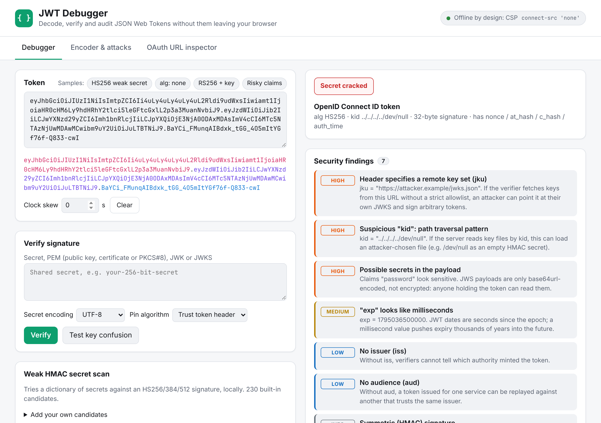

# JWT Debugger

**Decode, verify and security-audit JSON Web Tokens and OAuth 2.0 requests without them ever leaving your browser.**

[](https://github.com/DaveyD347/jwt-debugger/actions/workflows/ci.yml)
[](https://github.com/DaveyD347/jwt-debugger/actions/workflows/pages.yml)
[](LICENSE)

**Live:** https://daveyd347.github.io/jwt-debugger/



Pasting a production token into an online decoder hands a live credential to a third party. This tool does the same job, and a security review on top, as a static page with **no backend, no analytics, no dependencies and no build step**. Its Content-Security-Policy sets `connect-src 'none'`, so the browser itself blocks every outgoing request after the page loads. You can check that in DevTools, or read the ~1,500 lines of source.

## Features

### Decode and inspect
- Splits and decodes JWS (3-part) and recognises JWE (5-part) tokens; strips a leading `Bearer `.
- Colour-coded token, syntax-highlighted header and payload, and a table explaining each registered header parameter and claim.
- `exp`, `nbf`, `iat` and `auth_time` shown as UTC and relative time ("in 15m", "3d ago"), with configurable clock skew.
- Classifies the token as an OIDC ID token, OAuth 2.0 access token (RFC 9068 `at+jwt`), DPoP proof, logout token or generic JWT, and lists its scopes.

### Static security analysis
Every token is checked against the pitfalls in [RFC 8725 (JWT Best Current Practices)](https://www.rfc-editor.org/rfc/rfc8725) and well-known CVE classes:

| Check | Severity |
|---|---|
| `alg: none`, including case variants like `None` / `NONE` | critical |
| Empty signature on a signed alg (signature stripping) | high |
| `jku` / `x5u` remote key URLs, embedded `jwk` (CVE-2018-0114) | high |
| `kid` path traversal (`../../dev/null`), SQL-injection or shell metacharacters | high |
| RSA modulus < 2048 bits (inferred from signature length) | high |
| Secrets in the payload (`password`, `api_key`, `ssn`, …, at any depth) | high |
| Non-numeric `exp`/`nbf`/`iat` | high |
| Missing `exp`, expired, not yet valid, `iat` in the future | medium |
| Dates in milliseconds instead of seconds | medium |
| Lifetime over 24 h / 30 d | low / medium |
| DER-encoded ECDSA signature (JWS needs raw R‖S) | medium |
| `crit`, `b64: false`, `zip` on a JWS, JWE `RSA1_5` | medium |
| Missing `iss` / `aud` | low |

### Signature verification (WebCrypto)
- **HS256/384/512**, **RS256/384/512**, **PS256/384/512**, **ES256/384/512**, **EdDSA (Ed25519)**.
- Keys as a shared secret (UTF-8, Base64, Base64url or hex), SPKI `PUBLIC KEY` PEM, PKCS#1 `RSA PUBLIC KEY` PEM, X.509 `CERTIFICATE` PEM (the public key is extracted with a small DER parser), PKCS#8 `PRIVATE KEY` PEM, JWK, or a whole JWKS (selected by `kid`).
- **Algorithm pinning**: choose the algorithm your server expects and see the token rejected if the header says otherwise, as a correct verifier should.
- Warns when an HMAC secret is shorter than RFC 7518 §3.2 requires, or a JWK's `alg` disagrees with the token.

### Active tests
- **Weak HMAC secret scan.** A dictionary attack on HS* signatures with 230 built-in defaults (`secret`, `your-256-bit-secret`, `changeme`, framework placeholders, …) plus your own wordlist or file. Runs in batches so the page stays responsive, and can be stopped.
- **RS/ES to HS key-confusion test** (CVE-2016-10555 class). Checks whether an HS256 token was signed using the server's *public key* as the HMAC secret, trying the PEM with and without trailing newlines, CRLF line endings, and raw DER.
- **OIDC `at_hash` / `c_hash` check** against an access token or authorization code.

### Encoder and attack payloads
Sign tokens with any supported algorithm, generate keys and secrets in the browser, and build test tokens for checking your own verifier: `alg: none`, case-variant `None`, stripped signature, RS→HS key confusion, `kid=/dev/null` with an empty secret, and a self-signed embedded `jwk`.

> Only use attack payloads against systems you own or are authorised to test.

### OAuth 2.0 authorization URL inspector
Paste an `/authorize` URL to check it against [RFC 9700 (OAuth 2.0 Security BCP)](https://www.rfc-editor.org/rfc/rfc9700) and OIDC Core: implicit flow, missing or `plain` PKCE, missing `state` / `nonce`, non-HTTPS endpoints and redirect URIs (loopback allowed), wildcard or open-redirector redirect URIs, tokens or `client_secret` in the URL, and more.

## Privacy model

- No network: CSP `default-src 'none'; connect-src 'none'; form-action 'none'`. Scripts and styles load only from the page's own origin.
- No storage: nothing is written to `localStorage`, cookies or the URL. Closing the tab forgets everything.
- No dependencies: plain ES modules and the browser's WebCrypto API. Nothing to audit beyond `src/`.
- `Referrer-Policy: no-referrer`, and all rendering uses `textContent`, never `innerHTML`, so a hostile token cannot inject markup.

## Run locally

Any static file server works; ES modules and WebCrypto need `http://localhost` or HTTPS rather than `file://`.

```bash
git clone https://github.com/DaveyD347/jwt-debugger.git
cd jwt-debugger
python3 -m http.server 8080   # or: npm run serve
# open http://localhost:8080
```

## Tests

Node 20+ (uses the built-in test runner and WebCrypto, no packages to install):

```bash
npm test
```

The suite covers decoding edge cases, each analysis rule, sign/verify round-trips for every algorithm and key format, tampering, the jwt.io and RFC 7638 / OIDC Core test vectors, weak-secret scanning, key-confusion detection, empty-key HMAC, and the OAuth URL rules.

## Project layout

```
index.html          UI markup and the Content-Security-Policy
style.css           Light and dark themes
src/base64url.js    base64url / hex helpers
src/jwt.js          Decoding and static analysis (pure, no DOM)
src/crypto.js       WebCrypto verify/sign, key parsing, DER, secret scan, key-confusion test
src/oauth.js        Token classification, at_hash/c_hash, authorization URL review
src/wordlist.js     Built-in weak-secret candidates
src/app.js          DOM wiring
test/               node:test suites
.github/workflows/  CI (Node 20/22/24) and GitHub Pages deploy
```

## Deploying your own copy

Fork the repo, then in **Settings → Pages** set **Source** to **GitHub Actions**. Every push to `main` runs the tests and publishes the site.

## Implementation notes

- **Empty HMAC keys.** WebCrypto refuses zero-length HMAC keys, but HMAC zero-pads keys to the block size, so an empty key is exactly equivalent to the single byte `0x00`. The tool uses that to test the `kid=/dev/null` attack, and the test suite cross-checks it against Node's `createHmac`.
- **Certificates without a library.** `spkiFromCertificate` walks just enough DER to pull `SubjectPublicKeyInfo` from an X.509 certificate; `spkiFromPkcs1` wraps a PKCS#1 RSA key in SPKI so WebCrypto can import it.

## License

[MIT](LICENSE)
